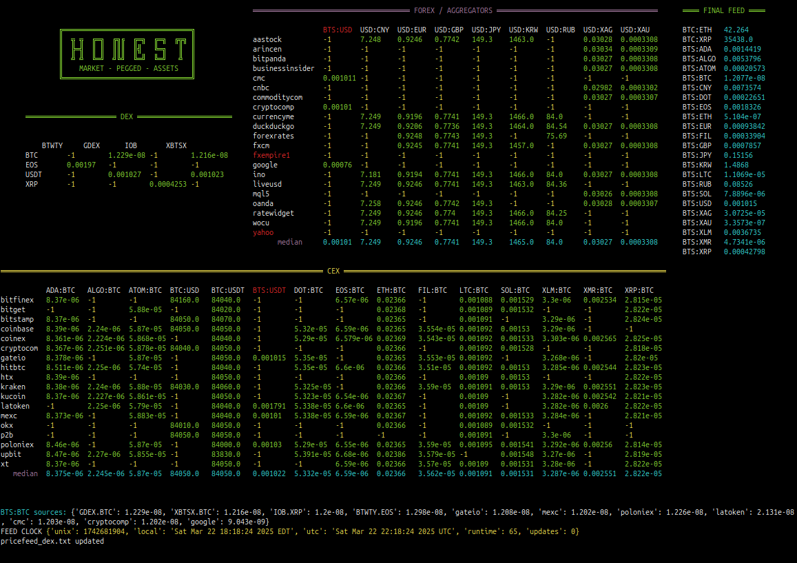

# Honest-MPA-Price-Feeds
Honest Price Feeds for Bitshares Market Pegged Assets

We are currently feeding an HONEST price hourly to 46 BitShares Market Pegged Assets: 

These are all fundamentally backed by the Bitshares core token (BTS) as collateral, meaning you "borrow them into existence" with BTS:

    HONEST.CNY
    HONEST.USD
    HONEST.BTC
    HONEST.XAU
    HONEST.XAG
    HONEST.ETH
    HONEST.XRP
    HONEST.USDSHORT
    HONEST.BTCSHORT
    HONEST.ADA
    HONEST.DOT
    HONEST.LTC
    HONEST.SOL
    HONEST.XMR
    HONEST.ATOM
    HONEST.XLM
    HONEST.ALGO
    HONEST.FIL
    HONEST.EOS
    HONEST.RUB
    HONEST.EUR
    HONEST.GBP
    HONEST.JPY
    HONEST.KRW
    HONEST.ADASHORT
    HONEST.DOTSHORT
    HONEST.LTCSHORT
    HONEST.SOLSHORT
    HONEST.XMRSHORT
    HONEST.ATOMSHORT
    HONEST.XLMSHORT
    HONEST.ALGOSHORT
    HONEST.FILSHORT
    HONEST.EOSSHORT
    HONEST.RUBSHORT
    HONEST.EURSHORT
    HONEST.GBPSHORT
    HONEST.JPYSHORT
    HONEST.KRWSHORT
    HONEST.XRPSHORT
    HONEST.ETHSHORT
    HONEST.XAUSHORT
    HONEST.XAGSHORT
    HONEST.CNYSHORT

(The `SHORT` tokens are fed the inverse (`1 / oracle`) of their base price, see [this document](short_tokens.md) to learn more about HONEST SHORT.)

The following two tokens are backed by HONEST.BTC as collateral, meaning you "borrow them into existence" with HONEST.BTC:

    HONEST.ETH1
    HONEST.XRP1

The HONEST.BTC backed MPA's are unique in the Bitshares ecosystem as they are the only MPA backed MPA's on the DEX.   

# Installation
You should be on a linux box.  The directions given below are for Ubuntu based distributions like Lubuntu or Linux Mint; if your OS is based on Fedora or Arch, you will need to modify package names slightly and use a different package manager like `dnf` or `pacman`.

First off, check your system's python version via `python3 -V`.  Python 3.9 or newer is supported.

If you do need to install a compatible version of python, follow these directions:

```bash
# Update the package list
sudo apt update
# Add the deadsnakes PPA
sudo apt install software-properties-common
sudo add-apt-repository ppa:deadsnakes/ppa
# Update the list again so that the python versions in the deadsnakes PPA show up
sudo apt update
# Install python3.10 along with other HONEST dependencies
sudo apt install python3.10 python3.10-venv python3.10-dev pkg-config libffi-dev libsecp256k1-dev git build-essential
```

Otherwise, simply install the base dependencies:

```bash
sudo apt update
sudo apt install python3-venv python3-dev pkg-config libffi-dev libsecp256k1-dev git build-essential
```

Now, `cd` into whatever directory you want to run HONEST feeds in, and run

```bash
# Create a virtual environment
# Note that if you did not have to install python, just use python3 here
python3.10 -m venv honest_env
# Activate it
source honest_env/bin/activate
# Install bitshares-signing
git clone https://github.com/squidKid-deluxe/bitshares-signing.git
pip install -e ./bitshares-signing
# Download this repository
git clone https://github.com/squidKid-deluxe/HONEST.git
cd HONEST
# Install requirements
pip install -r requirements.txt
# Enter the main directory of scripts
cd honest
```

You are now ready to deploy live.

    NOTE: You should certainly familiarize yourself with the scripts provided at this point
    you are about to enter your private keys which provide COMPLETE ACCESS TO YOUR FUNDS
    you SHOULD PERSONALLY ENSURE that you have read, understand, and trust the source code

Run

```bash
python HONEST.py
```

Choose `y + Enter` to enable publishing, then enter your BitShares `username` and `wif`.  Press `Enter` one last time and you are now an offical price feed producer for HONEST market pegged assets.  Welcome to the team!

## Headless mode

For unattended operation (cron, systemd, etc.), use `--headless` with environment variables:

```bash
export USERNAME=<your bitshares account name>
export WIF=<your bitshares wif>
export FEED_TOKEN=<github fine-grained token for HONEST-feeds-live>
python HONEST.py --headless --publish --oneshot
```

- `--publish` publishes prices to the blockchain
- `--snapshot-only` uploads the JSON snapshot to `HONEST-feeds-live` without publishing to the chain (no WIF needed)
- `--oneshot` runs a single pass instead of looping indefinitely
- `FEED_TOKEN` is required for snapshot uploads; without it, the upload is skipped and chain publishing continues as usual

## Snapshot publishing (HONEST-feeds-live)

Each producer publishes a public JSON snapshot of its current feed to `squidKid-deluxe/HONEST-feeds-live` via the GitHub Contents API. Set up the repo once (see `docs/feeds_live.md` for the full rollout checklist), then each machine needs only its own `FEED_TOKEN`.

Fetch any producer's snapshot from a browser:

```bash
curl -s https://raw.githubusercontent.com/squidKid-deluxe/HONEST-feeds-live/main/<account>.json | head -c 200
```

A body starting with `{"schema": 1` means it works.

## Tooling scripts

- `tooling/cex_scan.py` — scans ccxt exchanges for live price coverage per HONEST coin (BTC, USD, USDT), renders a coverage table and deviation plots. Run `python tooling/cex_scan.py` for a full scan, or `--from-json tooling/cex_sources.json` to re-render from cache.
- `render_price_logs.py` — renders price log source tables or plots BTS:BTC price history. Use `--latest` for the most recent log, `--count N` for the N most recent, or pass specific file paths.

From time to time this Github repository will be updated.  Please check in regularly at the HONEST mpa development room on telegram.  Whenever you update, we suggest using `git pull` in the `HONEST` directory rather than the `Download ZIP` button, so that should there be any errors in the latest development branch, it would then be easier to revert using `git checkout <commit-hash>`.

There is a streaming file `honest_cross_rates.txt` in the `pipe` folder so that custom or 3rd party integrations may use HONEST's curated price data.


I'm a chat mod in https://t.me/bitsharesDEV

or contact me via email:

f i n i t e s t a t e @tutamail.com

HONEST BDFL,

litepresence
